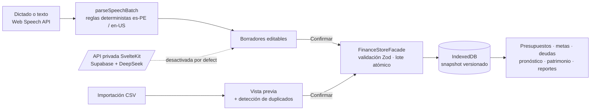

# Gestor Inteligente — finanzas personales local-first

> A local-first personal finance PWA (SvelteKit 2 + Svelte 5 + IndexedDB) with multi-currency accounts, budgets, CSV import and voice capture that turns "I spent 30 on a hotel and 12 on food" into reviewable transactions — no bank connection, no backend required.

**Estado:** MVP funcional (las fases de IA están diseñadas pero desactivadas)

## Qué problema resuelve

Las apps de finanzas personales suelen pedir conexión bancaria o guardar tus movimientos en su nube, y registrar gastos a mano da tanta pereza que se abandona. Esta app guarda todo **en tu navegador**. Permite registrar varios gastos dictándolos en una sola frase, y nada se guarda hasta que tú lo revisas y confirmas.

## Cómo funciona



Decisiones de diseño clave:

- **Local-first de verdad.** IndexedDB es la única fuente de verdad. Lo único que sale del dispositivo es la consulta de tasas de cambio y el JSON que exportas tú.
- **Nada se registra sin confirmación.** El dictado produce borradores editables. Un lote se valida completo antes de guardarse y, si un movimiento es inválido, no se guarda ninguno. Además, el último lote se puede deshacer.
- **Reglas deterministas antes que IA.** El parser de voz distingue importes de cantidades ("2 pasajes" no es dinero), entiende números en palabras y, cuando duda, propone "Por clasificar" en lugar de adivinar.
- **La IA nunca ejecuta, solo propone.** La API privada fuerza `operation: propose`, valida la respuesta del modelo con Zod y mantiene las claves solo en el servidor. Viene desactivada por defecto.
- **Migraciones de datos versionadas e idempotentes** (v6 → v10). Un snapshot corrupto o de una versión futura se rechaza antes de sobrescribirse, y se conservan 5 respaldos automáticos.

## Qué funciona hoy

Requiere Node.js 22 o posterior.

```bash
npm ci
npm run dev        # http://localhost:5173
npm run check      # svelte-check: 0 errores
npm test           # vitest: 56/56 pasan
```

- Funciones: cuentas multimoneda y transferencias, presupuestos, metas de ahorro, deudas, recurrentes, suscripciones detectadas, pronóstico de flujo de caja, cierre mensual, patrimonio neto, búsqueda, calendario, importación CSV, respaldo/restauración JSON, PWA offline y bloqueo con PIN local (se guarda solo hash y sal).
- Verificado: `npm ci`, `check`, `test` y `dev`; todas las páginas principales cargan.
- La especificación original del producto está en [`docs/especificacion-inicial.pdf`](docs/especificacion-inicial.pdf). Las decisiones de arquitectura están en [`docs/`](docs/).

## Qué no funciona / quedó pendiente

- **1 de 9 tests e2e (Playwright) falla en CI:** "guarda una transferencia con importe de destino en otra moneda". La transferencia se guarda, pero el inicio no muestra el saldo `USD 20.00`. No sé si es un bug del flujo multimoneda o un test desactualizado por un cambio de formato. Las otras 8 pruebas e2e, los tests unitarios, `check` y `build` pasan, pero la corrida de GitHub Actions queda en rojo por este test.
- **`npm run build` falla en Windows** en el paso de `adapter-vercel`, porque necesita crear symlinks (activa el Modo Desarrollador de Windows). La compilación en sí funciona, y en Linux/CI el build completo pasa.
- **IA y cuentas remotas sin terminar.** Las rutas `/api/v1/*` y los adaptadores de Supabase y DeepSeek existen, pero las capacidades siguen apagadas hasta tener un almacenamiento de cuotas, que no se implementó.
- No implementado: orquestador de intenciones o chatbot, respaldo cifrado en Google Drive y sincronización entre dispositivos.
- Los respaldos JSON no están cifrados.
- La interfaz está mayormente en español; `en-US` solo cubre categorías, formatos y CSV.
- El reconocimiento de voz depende del navegador; no todos lo soportan.

## Qué aprendí

- Diseñar **local-first** obliga a tomarse en serio las migraciones: sin servidor, cada versión de la app tiene que leer bien los datos de todas las anteriores.
- Un parser de voz con reglas, más una pantalla de revisión, da resultados confiables sin pagar por cada llamada a un LLM. La IA queda como mejora opcional, no como dependencia.
- Separar "proponer" de "ejecutar" (lotes atómicos con confirmación y deshacer) es lo que hace seguro automatizar el registro de dinero.
- Tener e2e en CI es valioso solo si se mantienen en verde. Lo dejé roto y perdió su función de alarma.

## Stack

SvelteKit 2 · Svelte 5 · TypeScript · Tailwind CSS v4 · IndexedDB (`idb-keyval`) · Zod · Chart.js · Vite PWA · Vitest · Playwright · GitHub Actions · (opcional) Supabase, DeepSeek

## Consideraciones sobre los datos

- Registra cada movimiento en la moneda de su cuenta. La conversión ocurre solo en los reportes globales.
- Configura una tasa de cambio antes de usar una cuenta en otra moneda que no sea la base.
- La moneda base se bloquea cuando ya existen datos.
- Para usar los servicios remotos opcionales, copia `.env.example` a `.env`. Nunca expongas `DEEPSEEK_API_KEY` con el prefijo `VITE_`. Los detalles están en [`docs/phase-2-api.md`](docs/phase-2-api.md).

## Licencia

© 2026 Jhon Villegas — [AGPL-3.0](LICENSE). Para uso comercial bajo otros términos, contáctame.
